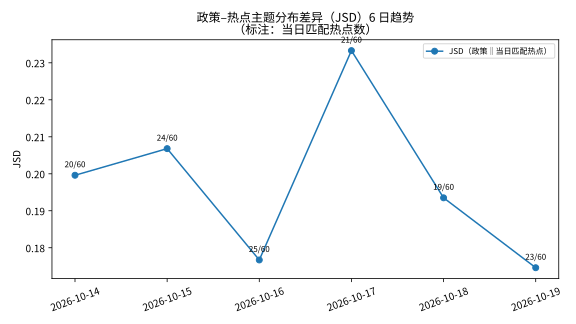

# 时间演化首轮分析报告（2026-10-19）：6 天热点时间序列

> 首次时间维度分析。输入：6 份每日快照（2026-10-14 → 2026-10-19，
> 360 条：微博 30×6 + 百度 30×6），全部校验干净、无缺失。
> 语义匹配沿用 v3 配置：`BAAI/bge-small-zh-v1.5`，阈值 0.45；
> 政策侧复用 863 段落与 15 个 v2 主题（TF-IDF+KMeans）。
> 运行脚本：`scripts/run_temporal_analysis.py`（可重跑）；
> 汇总：`data/processed/temporal_summary_20261019.json`（本地）。

## 1. 话题持续性：标题一天一换，人物/事件跨日延续

**标题级**（去标点/空白归一化后精确匹配）：6 天共 350 个不同话题，
**只有 1 个标题原样出现超过 1 天**（"官方通报女子高铁开免提电话1小时"，
百度，10-14→10-15）。热搜标题的日 churn 接近 100%——
同一事件每天都会换标题重新上榜。

**关键词级**（jieba 分词，≥2 字，135 个词出现 ≥2 天）才能看到真正的延续：

| 关键词 | 天数 | 平台 | 备注 |
|---|---|---|---|
| 肖战 | 4 | 微博+百度 | 演唱会相关系列（批文/票价/酒店涨价） |
| 演唱会 | 5 | 微博+百度 | 同上，事件主线 |
| 医生 | 4 | 微博+百度 | 医疗话题反复出现 |
| 老人 | 4 | 微博+百度 | 养老/社会话题 |
| iPhone | 4 | 微博+百度 | 国行 AI 功能 |
| 电话 | 4 | 微博+百度 | 高铁免提事件延续 |
| 暴跌 | 3 | 微博+百度 | 美股/AI 股 |
| 结婚 | 3 | 微博+百度 | 娱乐 |
| 回应/中国/AI | 6 | 微博+百度 | 泛词，信息量低 |

结论：**热搜的"事"是连续的，"标题"是不连续的**。做时间序列必须用
关键词/实体对齐，不能用标题精确匹配。

## 2. 平台差异：微博与百度几乎各说各话

每日微博–百度归一化标题 Jaccard 系数：

| 日期 | 重合标题数 | Jaccard |
|---|---|---|
| 10-14 | 3 | 0.053 |
| 10-15 | 2 | 0.035 |
| 10-16 | 0 | 0.000 |
| 10-17 | 2 | 0.035 |
| 10-18 | 2 | 0.035 |
| 10-19 | 0 | 0.000 |

**双平台标题重合度始终低于 6%**，两天甚至为 0。两个榜单反映的是
不同的人群注意力——跨平台结论不能互相替代，分析时必须分平台看。

## 3. 爆发检测：6 天基线太薄，无强爆发

对出现 ≥2 天的话题，分平台计算 6 日热度 z-score（缺席日记 0，
阈值 2.0）：**0 个话题触发爆发**。这不是"没有大事发生"，
而是 6 个点的基线根本撑不起可靠的 z 检验——
单日话题的 z 恒 ≈2.24，若不加"≥2 天"过滤会全员误报。
爆发检测至少需要 14 天以上数据才有意义，目前只能记录方法，
不能下结论。

## 4. 政策–热点关注差异（JSD）的 6 日趋势

每天 60 个热点用 BGE（阈值 0.45）匹配政策段落，取最佳匹配归入
15 个政策主题，计算当日匹配热点主题分布与政策主题分布的 JSD：

| 日期 | 匹配热点 | 匹配率 | 平均最佳相似度 | JSD |
|---|---|---|---|---|
| 10-14 | 20/60 | 33.3% | 0.438 | 0.200 |
| 10-15 | 24/60 | 40.0% | 0.439 | 0.207 |
| 10-16 | 25/60 | 41.7% | 0.448 | 0.177 |
| 10-17 | 21/60 | 35.0% | 0.437 | 0.233 |
| 10-18 | 19/60 | 31.7% | 0.437 | 0.194 |
| 10-19 | 23/60 | 38.3% | 0.425 | 0.175 |

**JSD 在 0.17–0.23 窄带内波动，无明显趋势**——6 天太短，
看不出"关注差异在扩大还是缩小"。能说的是：每天的政策–热点
分布差异都处于中等水平（0=完全一致，1=完全无关），
且匹配率稳定在 32%–42%（BGE+0.45 下的正常水平）。

6 天累计，被匹配热点的主题归属集中在：

| 政策主题 | 占比 |
|---|---|
| 主题6：建设/推进/城市 | 23.5% |
| 主题7：服务/养老/健康 | 12.1% |
| 主题4：材料/智能/人工智能 | 12.1% |
| 主题5：工程/发展/规划 | 7.6% |
| 主题11：增长/亿元/全省 | 7.6% |

即公众注意力的政策映射集中在**城市建设、养老健康、AI/新材料**——
与协同分析中"城乡建设是网络枢纽"的结论相互印证。

## 5. 诚实的问题清单

1. **只有 6 天**：趋势、爆发、周期性都谈不上，本轮只是"时间序列开箱"，
   证明管线能跑、口径能对齐。14 天后值得重跑一次。
2. **z-score 基线太薄**：6 个点做爆发检测，统计上站不住；已加"≥2 天"
   过滤避免全员误报，但结论仍弱。
3. **匹配是候选不是确认**：对决报告精度 0.22——JSD 算的是"候选匹配"的
   分布，约八成边可能是噪音；趋势解读以"稳定/波动"为限，不做强断言。
4. **标题归一化严格**：持续性结论依赖归一化口径；关键词级用 jieba，
   泛词（如"回应""中国"）会虚增持续性，解读时已剔除泛词、只看实体词。
5. **平台口径**：Jaccard 只比标题文本重合，不比热度；两天 Jaccard=0
   不代表两天大事完全不同（可能是同一事件不同标题）。

## 6. 产物清单

- `scripts/run_temporal_analysis.py` — 本轮独立可重跑脚本
- `reports/figures/fig6a_jsd_trend.svg` — JSD 6 日趋势
- `reports/figures/fig6b_persistence.svg` — 关键词跨日持续性 Top-14
- `reports/figures/fig6c_platform_overlap.svg` — 微博–百度标题重合度
- `data/processed/temporal_summary_20261019.json` — 全部数字（本地）
- 未建爆发图：0 个爆发，无图可画（诚实记录，非遗漏）。
