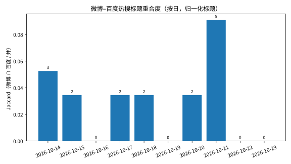
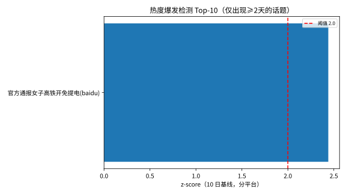
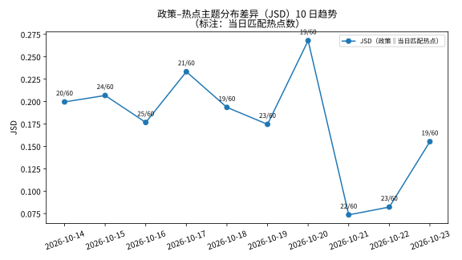
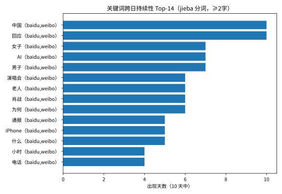

# 时间演化分析报告 v2（2026-10-23）：10 天热点时间序列

> v1（6 天）的续跑。输入：10 份每日快照（2026-10-14 → 2026-10-23，
> 600 条：微博 30×10 + 百度 30×10），全部校验干净、无缺失。
> 语义匹配沿用 v3 配置：`BAAI/bge-small-zh-v1.5`，阈值 0.45；
> 政策侧复用 863 段落与 15 个 v2 主题（TF-IDF+KMeans）。
> 运行脚本：`scripts/run_temporal_analysis.py`（可重跑，本轮运行标记 v2）；
> 汇总：`data/processed/temporal_summary_20261023.json`（本地）。
>
> **可复现性核验**：前 6 天的匹配数与 JSD 与 v1 报告逐项一致到小数点后三位
> （如 10-14：20/60、JSD 0.200；10-17：21/60、JSD 0.233），
> 说明 v2 是在同一口径上的延长，不是另起炉灶。

## 1. 话题持续性：标题仍然一天一换，故事线拉长到 6 天

**标题级**（去标点/空白归一化后精确匹配）：10 天共 583 个不同话题，
**仍然只有 1 个标题原样出现超过 1 天**（"官方通报女子高铁开免提电话1小时"，
百度，10-14→10-15，2 天）。窗口从 6 天拉到 10 天，标题 churn 的结论
不但成立，而且更强了：583 个标题里跨日复现率 0.2%。

**关键词级**（jieba 分词，≥2 字，286 个词出现 ≥2 天）：

| 关键词 | 天数 | 区间 | 备注 |
|---|---|---|---|
| AI | 7 | 10-14→10-20 | 国行 iPhone AI、英伟达等，多条线交织 |
| 演唱会 | 6 | 10-14→10-21 | 肖战演唱会系列（批文/票价/酒店涨价） |
| 肖战 | 6 | 10-14→10-23 | 同上，事件主线 |
| 老人 | 6 | 10-14→10-23 | 养老/社会话题，多点开花 |
| iPhone | 5 | 10-15→10-23 | 国行 AI 功能 |
| 通报 | 5 | 10-14→10-22 | 各类官方通报 |
| 电话 | 4 | 10-14→10-18 | 高铁免提事件，10-18 后消失 |
| 医生 | 4 | 10-14→10-18 | 医疗话题，10-18 后消失 |
| 中国/回应 | 10 | 全程 | 泛词，信息量低，不作解读 |

结论与 v1 一致：**热搜的"事"是连续的，"标题"是不连续的**。
10 天版的新信息是故事线的寿命：最长的单一事件线（肖战演唱会）
贯穿 6 天后在 10-21 结束；高铁免提线只活了 4 天。

## 2. 平台差异：10 天里 4 天零重合，最高的一天也不到 10%

每日微博–百度归一化标题 Jaccard 系数：

| 日期 | 重合标题数 | Jaccard |
|---|---|---|
| 10-14 | 3 | 0.053 |
| 10-15 | 2 | 0.035 |
| 10-16 | 0 | 0.000 |
| 10-17 | 2 | 0.035 |
| 10-18 | 2 | 0.035 |
| 10-19 | 0 | 0.000 |
| 10-20 | 2 | 0.035 |
| 10-21 | 5 | 0.091 |
| 10-22 | 0 | 0.000 |
| 10-23 | 0 | 0.000 |

10 天均值 0.028；**4 天完全零重合**，最高的一天（10-21，5 个标题）
也只有 0.091。v1"两个榜单各说各话"的结论完全保持——
跨平台分析必须分平台看，这一条现在有 10 天数据支撑。

## 3. 爆发检测：触发了 1 个，但它是窗口左缘的衰减事件

10 天基线（分平台、话题出现 ≥2 天、缺席日热度记 0、阈值 z≥2.0）：
**1 个触发**——

| 话题 | 平台 | 日期 | 热度 | z |
|---|---|---|---|---|
| 官方通报女子高铁开免提电话1小时 | 百度 | 10-14 | 7,809,046 | 2.44 |

必须诚实拆解这个"爆发"：该话题 10-14 排第 2（热度 781 万），
10-15 已跌到第 28（523 万），之后消失。它是**序列第一天的衰减中事件**，
不是序列中途新起的爆发；z 能过线靠的是 10 天基线里 8 个零热度日
把均值压低了——同一事件在 v1 的 6 天窗口里就没有触发。
所以这条结果的价值是**演示基线长度对 z 的敏感性**，
不是发现了一个爆发事件。10 天基线比 6 天好，但仍短于 14 天的
理想长度，爆发结论继续保留。

## 4. 政策–热点关注差异（JSD）的 10 日趋势：平稳是假象，波动才是常态

每天 60 个热点用 BGE（阈值 0.45）匹配政策段落，取最佳匹配归入
15 个政策主题，计算当日匹配热点主题分布与政策主题分布的 JSD：

| 日期 | 匹配热点 | 匹配率 | 平均最佳相似度 | JSD |
|---|---|---|---|---|
| 10-14 | 20/60 | 33.3% | 0.438 | 0.200 |
| 10-15 | 24/60 | 40.0% | 0.439 | 0.207 |
| 10-16 | 25/60 | 41.7% | 0.448 | 0.177 |
| 10-17 | 21/60 | 35.0% | 0.437 | 0.233 |
| 10-18 | 19/60 | 31.7% | 0.437 | 0.194 |
| 10-19 | 23/60 | 38.3% | 0.425 | 0.175 |
| 10-20 | 19/60 | 31.7% | 0.436 | **0.268** |
| 10-21 | 22/60 | 36.7% | 0.433 | **0.074** |
| 10-22 | 23/60 | 38.3% | 0.435 | **0.082** |
| 10-23 | 19/60 | 31.7% | 0.435 | 0.155 |

v1 在 6 天里看到的是"0.17–0.23 窄带内走平"；延长到 10 天，
区间立刻扩到 **0.074–0.268**——平稳是短窗口的假象。
三个新数据点值得拆解（用当日匹配主题分布核对过）：

- **10-20 冲到全程最高（0.268）**：当日匹配集中在主题11（增长/亿元/全省，
  21%）、主题6（建设/推进/城市，21%）、主题9（法治/广东/政府，16%），
  前四主题占约 69%；由"中国经济新亮点/韧性"类标题（相似度 0.65）
  领衔，另有若干弱匹配（如"仙人跳后报警…→主题6，0.47"）拉偏分布。
- **10-21、10-22 掉到全程最低（0.074、0.082）**：这两天匹配分布
  异常平坦（最大主题占比仅 18%、13%），且含多条真正贴近政策的热点——
  医保个人账户跨省共济→主题7（0.56）、年轻人在养老院服务减免房租→主题7
  （0.62）、前三季度中国经济"成绩单"→主题11（0.62）、
  体检查出这6种病→主题7（0.60）。匹配分布恰好最接近政策主题分布。
- **10-23 回到 0.155**：向中间回归。

但必须给一个降温的总判断：每天只有约 20 个匹配热点，
几条标题换个主题归属就能让当日 JSD 动 ±0.1；而匹配精度只有 0.22
（见对决报告），当日匹配集大半是噪音。**日级 JSD 以波动读数为限，
只有多日均值可解读**：10 天均值 0.176，前 5 日均值 0.202、
后 5 日均值 0.151——后段偏低主要由 10-21/22 两天拉动，
且被 10-20 的高点部分抵消，**仍无证据表明关注差异在系统性
扩大或缩小**。

10 天累计，被匹配热点的主题归属：

| 政策主题 | v2（10 天） | v1（6 天） |
|---|---|---|
| 主题6：建设/推进/城市 | 19.5% | 23.5% |
| 主题7：服务/养老/健康 | 13.5% | 12.1% |
| 主题4：材料/智能/人工智能 | 9.3% | 12.1% |
| 主题11：增长/亿元/全省 | 8.8% | 7.6% |
| 主题5：工程/发展/规划 | 6.5% | 7.6% |

前三集中度从 47.7% 降到 42.3%——数据变多后分布略微摊开，
但头部仍是**城市建设、养老健康、AI/新材料**，
与协同分析"城乡建设是网络枢纽"的结论继续相互印证。
10 天总匹配率 215/600 = 35.8%，日匹配率区间 31.7%–41.7%，
与 v1 的 32%–42% 完全同带。

## 5. v1 → v2 对照：什么变了，什么没变

**没变的（结论被更长数据加固）**

- 标题 churn 接近 100%：10 天仍然只有 1 个标题复现。
- 平台分离：重合度每天 <10%，4 天为 0。
- 匹配率稳定：每天三到四成，10 天无漂移。
- 头部主题不变：建设、养老、AI 依旧是公众注意力的政策映射集中区。
- 前 6 天数字与 v1 逐项一致——管线可复现。

**变了的（短窗口造成的错觉被修正）**

- JSD"窄带走平"→ 实际波动幅度（0.07–0.27）远大于任何漂移；
  趋势问题在 10 天尺度上依然无解，但理由从"没变化"
  变成"日级噪音太大、均值无方向"。
- 爆发 0 个 → 1 个，但拆解后是窗口左缘的衰减事件 + 基线长度效应，
  不是中途新起的爆发。
- 关键词持续性计数随天数机械增长（135→286 个词 ≥2 天）；
  实体故事线有了明确寿命（演唱会线 6 天、高铁免提线 4 天）。

## 6. 诚实的问题清单

1. **10 天仍不足 14 天**：爆发检测的基线只有 10 个点，
   本轮唯一的触发已证明对基线长度敏感；14 天后仍值得再跑。
2. **日级 JSD 噪音主导**：每天约 20 个匹配、精度 0.22，
   日与日之间的 0.07–0.27 摆动大部分是抽样噪音；
   本报告只解读多日均值与分布结构，不断言单日升降的原因链。
3. **爆发口径的零填充假设**：话题缺席日热度记 0 会系统性抬高
   在榜首日的 z；这是本方法的已知偏差，已用"≥2 天"过滤部分缓解。
4. **标题归一化严格**：持续性结论依赖归一化口径；关键词级用 jieba，
   泛词（中国/回应/为何）会虚增持续性，解读时已剔除、只看实体词。
5. **平台口径**：Jaccard 只比标题文本重合，不比热度；
   Jaccard=0 不代表两边大事完全不同（可能是同一事件不同标题）。

## 7. 产物清单

- `scripts/run_temporal_analysis.py` — 可重跑脚本（本轮起运行标记 v2，
  图号 fig7*，与 v1 的 fig6* 并存不覆盖）
- `reports/temporal_analysis_v2_20261023.md` — 本报告
- `reports/figures/fig7a_jsd_trend.svg` — JSD 10 日趋势
- `reports/figures/fig7b_persistence.svg` — 关键词跨日持续性 Top-14
- `reports/figures/fig7c_platform_overlap.svg` — 微博–百度标题重合度（10 日）
- `reports/figures/fig7d_bursts.svg` — 爆发检测（1 个触发，见 §3 拆解）
- `data/processed/temporal_summary_20261023.json` — 全部数字（本地）
