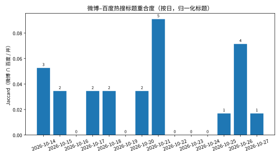
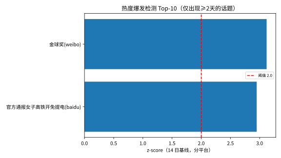
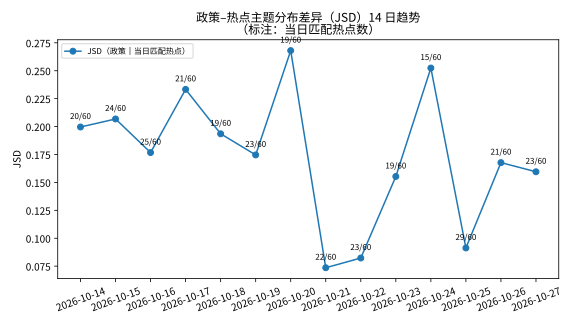
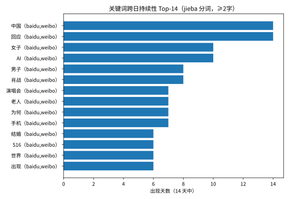

# 时间演化分析报告 v3（2026-10-27）：14 天热点时间序列

> v2（10 天）的续跑。输入：14 份每日快照（2026-10-14 → 2026-10-27，
> 840 条：微博 30×14 + 百度 30×14），全部校验干净、无缺失。
> 语义匹配沿用 v3 配置：`BAAI/bge-small-zh-v1.5`，阈值 0.45；
> 政策侧复用 863 段落与 15 个 v2 主题（TF-IDF+KMeans）。
> 运行脚本：`scripts/run_temporal_analysis.py`（可重跑，本轮运行标记 v3）；
> 汇总：`data/processed/temporal_summary_20261027.json`（本地）。
>
> **可复现性核验**：前 10 天的匹配数与 JSD 与 v2 报告逐项一致到小数点后三位
> （如 10-14：20/60、JSD 0.200；10-20：19/60、JSD 0.268；10-21：22/60、JSD 0.074），
> 说明 v3 是在同一口径上的延长，不是另起炉灶。

## 1. 话题持续性：标题 churn 依旧接近 100%，实体故事线拉长

**标题级**（去标点/空白归一化后精确匹配）：14 天共 816 个不同话题，
**只有 2 个标题原样出现超过 1 天**（跨日复现率 0.25%），
且这两个恰好就是 §3 的两个爆发检出对象。
窗口从 10 天拉到 14 天，标题 churn 的结论进一步加固：
**热搜的"事"是连续的，"标题"是不连续的**——时间序列追踪必须
按关键词/实体对齐，不能按标题匹配。

**关键词级**（jieba 分词，≥2 字，458 个词出现 ≥2 天，v2 为 286 个）：

| 关键词 | 天数 | 区间 | 备注 |
|---|---|---|---|
| AI | 10 | 10-14→10-27 | iPhone AI、英伟达等，多条线交织 |
| 女子 | 10 | 10-14→10-27 | 社会新闻高频主语，偏泛词 |
| 肖战 | 8 | 10-14→10-27 | 演唱会事件主线（v2 为 6 天，现延长至 8 天） |
| 男子 | 8 | 10-14→10-24 | 社会新闻高频主语，偏泛词 |
| 演唱会 | 7 | 10-14→10-26 | 肖战演唱会系列（批文/票价/酒店涨价） |
| 老人 | 7 | 10-14→10-26 | 养老/社会话题，多点开花 |
| 手机 | 7 | 10-16→10-27 | AI 手机功能线 |
| 结婚 | 6 | 10-15→10-26 | 娱乐/社会话题 |
| S16 | 6 | 10-15→10-27 | 英雄联盟世界赛 |
| 中国/回应 | 14 | 全程 | 泛词，信息量低，不作解读 |

实体故事线的寿命继续拉长：肖战线从 v2 的 6 天延长到 8 天，
演唱会线 7 天，S16 电竞线 6 天且仍在窗口末尾延续。

## 2. 平台差异：14 天均值 0.028，5 天零重合

每日微博–百度归一化标题 Jaccard 系数：

| 日期 | 重合标题数 | Jaccard | 日期 | 重合标题数 | Jaccard |
|---|---|---|---|---|---|
| 10-14 | 3 | 0.053 | 10-21 | 5 | 0.091 |
| 10-15 | 2 | 0.035 | 10-22 | 0 | 0.000 |
| 10-16 | 0 | 0.000 | 10-23 | 0 | 0.000 |
| 10-17 | 2 | 0.035 | 10-24 | 0 | 0.000 |
| 10-18 | 2 | 0.035 | 10-25 | 1 | 0.017 |
| 10-19 | 0 | 0.000 | 10-26 | 4 | 0.071 |
| 10-20 | 2 | 0.035 | 10-27 | 1 | 0.017 |

14 天均值 0.028，与 v2 的 0.028 完全相同；**5 天完全零重合**，
最高的一天仍是 10-21（0.091）。"两个榜单各说各话"的结论
在 14 天数据上纹丝不动——跨平台分析必须分平台看。

## 3. 爆发检测：14 天基线检出 2 个——1 个是真事件，1 个是方法伪影

14 天基线（分平台、话题出现 ≥2 天、缺席日热度记 0、阈值 z≥2.0）：

| 话题 | 平台 | 日期 | 热度 | z |
|---|---|---|---|---|
| 金球奖 | 微博 | 10-27 | 461,285 | 3.12 |
| 官方通报女子高铁开免提电话1小时 | 百度 | 10-14 | 7,809,046 | 2.95 |

### 3.1 金球奖：事件层面证实为真爆发，但 z 值本身仍被零填充抬高

这是本轮的核心问题——14 天基线能不能抓到**真**爆发？
先看事件层面的证据：2026 年金球奖颁奖就在 10-27 当天，
"凯恩获2026年金球奖"登上微博第 1、百度第 5；
当天微博有 5 条金球奖相关标题（第 1/4/9/19/29 位），
百度有 2 条（第 5/7 位）。前一天 10-26，"金球奖"已在微博
第 26 位预热（热度 25.6 万）。这是一个**上升沿事件**：
预热 → 颁奖日全榜爆发，符合真实爆发的时间形态。

但必须同时拆穿 z 值的水分：被检出的归一化标题"金球奖"
在 14 天里只有 2 个非零日，其余 12 天记 0；
z=3.12 的计算方式与 v2 的伪影完全相同（零填充压低均值、
抬高单日 z）。而且真正的头条"凯恩获2026年金球奖"只出现 1 天，
按"≥2 天"规则根本进不了检测——方法抓住的是通用词，
不是事件本身的标题。

**结论：金球奖是"事件证实为真、但 z 值不可全信"的爆发。**
与 v2 的伪影相比，区别不在计算方式，而在事件形态：
上升沿 + 多标题同日共振（事件级证据）vs 衰减沿 + 孤标题
（v2 的高铁免提）。14 天基线没有解决零填充偏差，
但它让"事件级交叉验证"成为可能——这是本轮方法论上的
真正收获：**标题级 z 只能做初筛，事件级证据才是定性依据**。

### 3.2 高铁免提：基线拉长后 z 反而更高，伪影被坐实

v2 已拆解过的同一事件，在 14 天基线里 z 从 2.44 **升到 2.95**。
原因很直白：零填充日从 8 个变成 12 个，均值被压得更低，
单日 z 自然更高。**基线越长，这个伪影越显著**——
零填充 z-score 对窗口左缘的衰减事件存在系统性误报，
且随窗口延长而加重，不是减轻。这是 v3 对方法本身
最有价值的否定性发现：14 天达到了"理想基线长度"，
却没有解决这个偏差；下一轮改进方向应是去掉零填充
（只对在榜日算基线，或改用排名跃升口径），而不是继续加天数。

## 4. 政策–热点关注差异（JSD）的 14 日趋势：仍是波动，不是漂移

每天 60 个热点用 BGE（阈值 0.45）匹配政策段落，取最佳匹配归入
15 个政策主题，计算当日匹配热点主题分布与政策主题分布的 JSD：

| 日期 | 匹配热点 | 匹配率 | 平均最佳相似度 | JSD |
|---|---|---|---|---|
| 10-14 | 20/60 | 33.3% | 0.438 | 0.200 |
| 10-15 | 24/60 | 40.0% | 0.439 | 0.207 |
| 10-16 | 25/60 | 41.7% | 0.448 | 0.177 |
| 10-17 | 21/60 | 35.0% | 0.437 | 0.233 |
| 10-18 | 19/60 | 31.7% | 0.437 | 0.194 |
| 10-19 | 23/60 | 38.3% | 0.425 | 0.175 |
| 10-20 | 19/60 | 31.7% | 0.436 | **0.268** |
| 10-21 | 22/60 | 36.7% | 0.433 | **0.074** |
| 10-22 | 23/60 | 38.3% | 0.435 | **0.082** |
| 10-23 | 19/60 | 31.7% | 0.435 | 0.155 |
| 10-24 | 15/60 | 25.0% | — | 0.252 |
| 10-25 | 29/60 | 48.3% | — | 0.091 |
| 10-26 | 21/60 | 35.0% | — | 0.168 |
| 10-27 | 23/60 | 35.0% | — | 0.160 |

14 天 JSD 区间 **0.074–0.268**，与 v2 的极值完全相同
（最高仍是 10-20，最低仍是 10-21）——新增 4 天没有
刷新任何极值，波动带已经稳定。14 天均值 0.174；
前 7 天均值 0.208，后 7 天均值 0.140——**后段均值偏低，
但不能读成"差异在缩小"**：后段的低均值由三个极低日
（10-21 的 0.074、10-22 的 0.082、10-25 的 0.091）拉动，
而 10-24 的 0.252 同时在场；日级摆动幅度（±0.1）
远大于前后段均值差，且每天只有约 20 个匹配、
匹配精度约 0.22，日级 JSD 仍以噪音为主。
**趋势判断与 v2 一致：无系统性扩大或缩小的证据。**

新增 4 天值得拆解的两端：

- **10-24（15/60，全程最低匹配数，JSD 0.252）**：
  匹配分布只有 15 个样本，头部主题海洋/发展/产业占 4/15（27%），
  且多条匹配偏弱（如"西藏地震救援→建设/城市"0.51、
  "办酒生女不领证被诉骗婚→行政/执法"0.46）——
  小样本 lumpiness + 弱匹配共同推高了 JSD。
- **10-25（29/60，全程最高匹配数，JSD 0.091）**：
  匹配横跨 13 个主题，分布最摊开；且含多条真正贴近政策的热点——
  31省份人口出生率→养老/健康（0.58）、出口首破8万亿→增长（0.58）、
  渝昆高铁全线铺轨→建设（0.55）。与 10-21/22 的低 JSD 日同构：
  **匹配多且分布摊开的日子，JSD 自然低**。

14 天累计，被匹配热点的主题归属：

| 政策主题 | v3（14 天） | v2（10 天） |
|---|---|---|
| 主题6：建设/推进/城市 | 18.8% | 19.5% |
| 主题7：服务/养老/健康 | 11.9% | 13.5% |
| 主题4：材料/智能/人工智能 | 10.9% | 9.3% |
| 主题11：增长/亿元/全省 | 9.6% | 8.8% |
| 主题5：工程/发展/规划 | 5.9% | 6.5% |

前三集中度 41.6%（v2 为 42.3%），基本不变；
头部仍是**城市建设、养老健康、AI/新材料**，
与协同分析"城乡建设是网络枢纽"的结论继续相互印证。
14 天总匹配率 303/840 = 36.1%，与 v2 的 35.8% 同带。

## 5. v2 → v3 对照：什么变了，什么没变

**没变的（结论被更长数据加固）**

- 标题 churn 接近 100%：14 天 816 个标题，只有 2 个复现。
- 平台分离：重合度均值 0.028 不变，5 天为 0，最高日仍 <10%。
- 匹配率稳定：14 天总匹配率 36.1%，与 v2 的 35.8% 同带。
- 头部主题不变：建设、养老、AI 依旧是公众注意力的政策映射集中区。
- JSD 波动带稳定：新增 4 天未刷新极值（0.074–0.268）。
- 前 10 天数字与 v2 逐项一致——管线可复现。

**变了的（14 天基线带来的新信息）**

- 爆发 1 个 → 2 个：新增的金球奖是事件级证实的真爆发
  （上升沿 + 多标题共振），但 z 值仍被零填充抬高——
  结论从"基线不够长"升级为"零填充口径本身有偏"。
- 高铁免提伪影的 z 从 2.44 升到 2.95：**基线拉长加重了
  左缘衰减事件的误报**，这是 v2 未能预见的方法教训。
- 实体故事线寿命继续延长：肖战线 6→8 天，演唱会线 6→7 天。
- 后 7 天 JSD 均值低于前 7 天（0.140 vs 0.208），
  但由三个极低日驱动，不构成趋势证据。

## 6. 诚实的问题清单

1. **零填充偏差未解决**：14 天达到了预设的"理想基线长度"，
   但高铁免提的 z 反而升高，证明加天数不能修复这个偏差；
   下一轮应改口径（在榜日基线，或排名跃升），而不是继续加天数。
2. **标题级 z 只能初筛**：金球奖的案例表明，真正的定性
   需要事件级证据（同日多标题共振、上升沿形态）；
   本报告对两个检出对象都做了事件级复核，单看 z 会误判。
3. **日级 JSD 仍噪音主导**：每天约 20 个匹配、精度 0.22，
   日与日之间的摆动大部分是抽样噪音；本报告只解读多日均值
   与分布结构，不断言单日升降的原因链。
4. **标题归一化严格**：持续性结论依赖归一化口径；关键词级用 jieba，
   泛词（中国/回应/为何）会虚增持续性，解读时已剔除、只看实体词。
5. **平台口径**：Jaccard 只比标题文本重合，不比热度；
   Jaccard=0 不代表两边大事完全不同（可能是同一事件不同标题）。

## 7. 产物清单

- `scripts/run_temporal_analysis.py` — 可重跑脚本（本轮起运行标记 v3，
  图号 fig8*，与 v1/v2 的 fig6*/fig7* 并存不覆盖）
- `reports/temporal_analysis_v3_20261027.md` — 本报告
- `reports/figures/fig8a_jsd_trend.svg` — JSD 14 日趋势
- `reports/figures/fig8b_persistence.svg` — 关键词跨日持续性 Top-14
- `reports/figures/fig8c_platform_overlap.svg` — 微博–百度标题重合度（14 日）
- `reports/figures/fig8d_bursts.svg` — 爆发检测（2 个触发，见 §3 拆解）
- `data/processed/temporal_summary_20261027.json` — 全部数字（本地）
