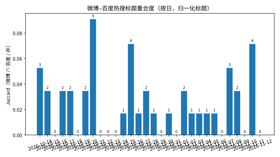
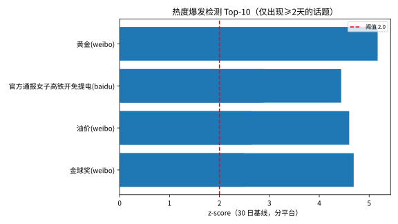
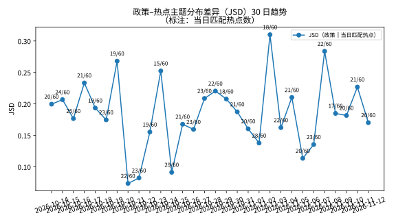
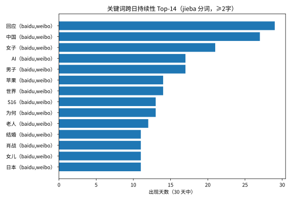

# 时间演化分析报告 v4（2026-11-12）：30 天热点时间序列

> v3（14 天）的续跑。输入：30 份每日快照（2026-10-14 → 2026-11-12，
> 1800 条：微博 30×30 + 百度 30×30），全部校验干净、无缺失。
> 语义匹配沿用 v3 配置：`BAAI/bge-small-zh-v1.5`，阈值 0.45；
> 政策侧复用 863 段落与 15 个 v2 主题（TF-IDF+KMeans）。
> 运行脚本：`scripts/run_temporal_analysis.py`（可重跑，本轮运行标记 v4）；
> 汇总：`data/processed/temporal_summary_20261112.json`（本地）。
>
> **可复现性核验**：前 14 天的匹配数与 JSD 与 v3 报告逐项一致到小数点后三位
> （如 10-14：20/60、JSD 0.200；10-20：19/60、JSD 0.268；10-27：23/60、JSD 0.160），
> 说明 v4 是在同一口径上的延长，不是另起炉灶。

## 1. 话题持续性：标题 churn 依旧接近 100%，泛词线拉到整月

**标题级**（去标点/空白归一化后精确匹配）：30 天共 1755 个不同话题，
**只有 4 个标题原样出现超过 1 天**（跨日复现率 0.22%），
且这 4 个恰好就是 §3 的爆发检出对象（高铁免提、油价、金球奖、黄金）。
窗口从 14 天拉到 30 天，标题 churn 的结论进一步加固：
**热搜的"事"是连续的，"标题"是不连续的**——时间序列追踪必须
按关键词/实体对齐，不能按标题匹配。

**关键词级**（jieba 分词，≥2 字）：

| 关键词 | 天数 | 区间 | 备注 |
|---|---|---|---|
| 回应 | 29 | 10-14→11-12 | 泛词，信息量低，不作解读 |
| 中国 | 27 | 10-14→11-12 | 泛词，信息量低，不作解读 |
| 女子 | 21 | 10-14→11-12 | 社会新闻高频主语，偏泛词 |
| AI | 17 | 10-14→11-12 | iPhone AI、英伟达等，多条线交织 |
| 男子 | 17 | 10-14→11-12 | 社会新闻高频主语，偏泛词 |
| 苹果 | 14 | 10-14→11-08 | iPhone 相关线 |
| 世界 | 14 | 10-17→11-11 | 泛词，信息量低 |
| S16 | 13 | 10-15→11-09 | 英雄联盟世界赛线，窗口内结束 |
| 为何 | 13 | 10-14→11-12 | 泛词 |
| 老人 | 12 | 10-14→11-11 | 养老/社会话题，多点开花 |
| 结婚 | 11 | 10-15→11-12 | 娱乐/社会话题 |
| 肖战 | 11 | 10-14→11-01 | 演唱会事件主线（v3 为 8 天，现延长至 11 天，11-01 后断线） |

实体故事线的寿命继续拉长：肖战线从 v3 的 8 天延长到 11 天
（11-01 后断线，事件周期完整闭合）；S16 电竞线 13 天，
在窗口内结束。泛词（回应/中国）几乎全程出现，但不作解读。

## 2. 平台差异：30 天均值 0.024，10 天零重合

每日微博–百度归一化标题 Jaccard 系数：

| 日期 | 重合标题数 | Jaccard | 日期 | 重合标题数 | Jaccard |
|---|---|---|---|---|---|
| 10-14 | 3 | 0.053 | 10-30 | 0 | 0.000 |
| 10-15 | 2 | 0.035 | 10-31 | 1 | 0.017 |
| 10-16 | 0 | 0.000 | 11-01 | 0 | 0.000 |
| 10-17 | 2 | 0.035 | 11-02 | 2 | 0.035 |
| 10-18 | 2 | 0.035 | 11-03 | 1 | 0.017 |
| 10-19 | 0 | 0.000 | 11-04 | 1 | 0.017 |
| 10-20 | 2 | 0.035 | 11-05 | 1 | 0.017 |
| 10-21 | 5 | 0.091 | 11-06 | 1 | 0.017 |
| 10-22 | 0 | 0.000 | 11-07 | 0 | 0.000 |
| 10-23 | 0 | 0.000 | 11-08 | 3 | 0.053 |
| 10-24 | 0 | 0.000 | 11-09 | 2 | 0.035 |
| 10-25 | 1 | 0.017 | 11-10 | 0 | 0.000 |
| 10-26 | 4 | 0.071 | 11-11 | 4 | 0.071 |
| 10-27 | 1 | 0.017 | 11-12 | 0 | 0.000 |
| 10-28 | 2 | 0.035 | | | |
| 10-29 | 1 | 0.017 | | | |

30 天均值 0.024（v3 为 0.028）；**10 天完全零重合**，
最高的一天仍是 10-21（0.091），新增 16 天没有刷新最高值。
"两个榜单各说各话"的结论在 30 天数据上纹丝不动——
跨平台分析必须分平台看。

## 3. 爆发检测：30 天基线检出 7 个——方法偏差随窗口拉长而加重

30 天基线（分平台、话题出现 ≥2 天、缺席日热度记 0、阈值 z≥2.0）：

| 话题 | 平台 | 日期 | 热度 | z |
|---|---|---|---|---|
| 黄金 | 微博 | 11-06 | 1,021,065 | **5.17** |
| 金球奖 | 微博 | 10-27 | 461,285 | 4.69 |
| 油价 | 微博 | 11-12 | 495,146 | 4.60 |
| 官方通报女子高铁开免提电话1小时 | 百度 | 10-14 | 7,809,046 | 4.44 |
| 官方通报女子高铁开免提电话1小时 | 百度 | 10-15 | 5,227,142 | 2.89 |
| 油价 | 微博 | 10-30 | 295,054 | 2.64 |
| 金球奖 | 微博 | 10-26 | 256,255 | 2.49 |

### 3.1 最重要的发现：同一事件的 z 值随窗口拉长系统性膨胀

v3 已经预言了这个现象，v4 在两个旧事件上同时证实了它：

- **金球奖**：z 从 v3 的 3.12 **升到 4.69**，事件本身没变，
  变的只是基线从 14 天拉到 30 天、零填充日从 12 个变成 28 个。
- **高铁免提**：z 从 v3 的 2.95 **升到 4.44**，且 10-15 的
  第二天也被单独检出（z=2.89）——同一个衰减事件在 30 天基线里
  占了两个报警名额。

**跨轮次比较 z 值已经没有意义**：z=5.17 的"黄金"并不比
z=3.12 的"金球奖"更像爆发——数字膨胀来自零填充日变多，
不是事件更强。这是 v4 对方法本身最有价值的否定性发现：
30 天达到了"理想基线长度"的两倍，偏差不减反增；
**下一轮必须改口径（只对在榜日算基线，或改用排名跃升），
而不是继续加天数。**

### 3.2 新检出的两个词：事件证据都很弱

- **黄金（11-06，z=5.17，全轮最高）**：当天微博第 5 位的孤标题
  "黄金"，前后 30 天里只出现 2 天（10-31、11-06），
  快照里没有同日多标题共振。按 v3 确立的"事件级证据"标准，
  它**不能定性为爆发**——只能说"被算法报了警"。
  它的 z 值最高，恰恰说明 z 值的排序也不可信。
- **油价（11-12，z=4.60；10-30，z=2.64）**：同一个通用词
  在 13 天里两次孤立上榜、两次都被报警。复发性通用词
  是零填充口径的又一误报形态：它量的是"词偶尔出现"，
  不是"事件突然爆发"。

**结论：7 个报警里只有 1 个经事件级证实（金球奖），
其余 6 个都是零填充口径的产物。** 标题级 z 只能做初筛，
定性必须靠事件级证据（同日多标题共振、上升沿形态）；
本报告对每个检出对象都做了快照级复核，单看 z 会误判。

## 4. 政策–热点关注差异（JSD）的 30 日趋势：仍是波动，不是漂移

每天 60 个热点用 BGE（阈值 0.45）匹配政策段落，取最佳匹配归入
15 个政策主题，计算当日匹配热点主题分布与政策主题分布的 JSD。
30 天逐日结果（前 14 天与 v3 逐项一致，见可复现性核验）：

| 日期 | 匹配热点 | JSD | 日期 | 匹配热点 | JSD |
|---|---|---|---|---|---|
| 10-14 | 20/60 | 0.200 | 10-30 | 18/60 | 0.208 |
| 10-15 | 24/60 | 0.207 | 10-31 | 21/60 | 0.187 |
| 10-16 | 25/60 | 0.177 | 11-01 | 20/60 | 0.160 |
| 10-17 | 21/60 | 0.233 | 11-02 | 28/60 | 0.138 |
| 10-18 | 19/60 | 0.194 | 11-03 | 18/60 | **0.310** |
| 10-19 | 23/60 | 0.175 | 11-04 | 22/60 | 0.162 |
| 10-20 | 19/60 | 0.268 | 11-05 | 21/60 | 0.210 |
| 10-21 | 22/60 | 0.074 | 11-06 | 20/60 | 0.114 |
| 10-22 | 23/60 | 0.082 | 11-07 | 23/60 | 0.135 |
| 10-23 | 19/60 | 0.155 | 11-08 | 22/60 | 0.284 |
| 10-24 | 15/60 | 0.252 | 11-09 | 17/60 | 0.185 |
| 10-25 | 29/60 | 0.091 | 11-10 | 20/60 | 0.182 |
| 10-26 | 21/60 | 0.168 | 11-11 | 21/60 | 0.227 |
| 10-27 | 23/60 | 0.160 | 11-12 | 20/60 | 0.170 |
| 10-28 | 23/60 | 0.209 | | | |
| 10-29 | 22/60 | 0.220 | | | |

30 天 JSD 区间 **0.074–0.310**，均值 0.185（v3 为 0.174）。
新增 16 天刷新了上限：**11-03 的 0.310 是全程新高**，
11-08 的 0.284 是第二高。两个新高日有共同点：
匹配数偏低（11-03 为 18/60，11-08 为 22/60），
且 11-03 当天榜单以社会新闻/娱乐为主（结婚离世、国乒、
网约车、短剧），与 v3 拆解过的 10-24 同构——
**小样本 lumpiness + 弱匹配共同推高 JSD**，不是政策
或舆论发生了结构性变化。

前后半程对照：前 15 天（10-14→10-28）匹配率 36.2%、
JSD 均值 0.176；后 15 天（10-29→11-12）匹配率 34.8%、
JSD 均值 0.193。**后段均值略高，但差值（0.017）远小于
日级摆动幅度（±0.1），且两个半程的匹配率同带**——
无系统性扩大或缩小的证据，结论与 v2/v3 一致：
**波动，不是漂移**。

30 天累计，被匹配热点的主题归属：

| 政策主题 | v4（30 天） | v3（14 天） |
|---|---|---|
| 主题6：建设/推进/城市 | 18.3% | 18.8% |
| 主题4：材料/智能/人工智能 | 11.9% | 10.9% |
| 主题7：服务/养老/健康 | 10.9% | 11.9% |
| 主题11：增长/亿元/全省 | 9.2% | 9.6% |
| 主题3：海洋/发展/产业 | 7.4% | 5.9% |

前三集中度 41.1%（v3 为 41.6%），基本不变；
头部仍是**城市建设、AI/新材料、养老健康**，
与协同分析"城乡建设是网络枢纽"的结论继续相互印证。
30 天总匹配率 639/1800 = 35.5%，与 v3 的 36.1% 同带。

## 5. v3 → v4 对照：什么变了，什么没变

**没变的（结论被更长数据加固）**

- 标题 churn 接近 100%：30 天 1755 个标题，只有 4 个复现。
- 平台分离：重合度均值 0.024，10 天为 0，最高日仍 <10%。
- 匹配率稳定：30 天总匹配率 35.5%，与 v3 的 36.1% 同带。
- 头部主题不变：建设、AI、养老依旧是公众注意力的政策映射集中区。
- JSD 无趋势：前后半程均值差 0.017，远小于日级摆动。
- 前 14 天数字与 v3 逐项一致——管线可复现。

**变了的（30 天基线带来的新信息）**

- JSD 上限被刷新：11-03 的 0.310、11-08 的 0.284，
  均为小样本 + 弱匹配日，不是结构性变化。
- 爆发报警 2 个 → 7 个：新增的黄金、油价事件证据弱，
  且旧事件的 z 值系统性膨胀（金球奖 3.12→4.69，
  高铁免提 2.95→4.44）——**跨轮次比较 z 值已无意义，
  方法必须改口径**。
- 实体故事线完整闭合：肖战线 8→11 天后断线，
  S16 线 13 天后结束；泛词线（回应/中国）拉到整月。

## 6. 诚实的问题清单

1. **零填充偏差未解决且已加重**：30 天基线让同一事件的 z
   系统性膨胀，报警数从 2 涨到 7，其中 6 个无事件级证据；
   下一轮应改口径（在榜日基线，或排名跃升），而不是继续加天数。
2. **标题级 z 只能初筛**：7 个报警里只有 1 个经事件级证实；
   本报告对每个检出对象都做了快照级复核，单看 z 会误判。
3. **日级 JSD 仍噪音主导**：每天约 21 个匹配、精度 0.22，
   日与日之间的摆动大部分是抽样噪音；本报告只解读多日均值
   与分布结构，不断言单日升降的原因链。
4. **标题归一化严格**：持续性结论依赖归一化口径；关键词级用 jieba，
   泛词（中国/回应/为何）会虚增持续性，解读时已剔除、只看实体词。
5. **平台口径**：Jaccard 只比标题文本重合，不比热度；
   Jaccard=0 不代表两边大事完全不同（可能是同一事件不同标题）。

## 7. 产物清单

- `scripts/run_temporal_analysis.py` — 可重跑脚本（本轮起运行标记 v4，
  图号 fig9*，与 v1/v2/v3 的 fig6*/fig7*/fig8* 并存不覆盖）
- `reports/temporal_analysis_v4_20261112.md` — 本报告
- `reports/figures/fig9a_jsd_trend.svg` — JSD 30 日趋势
- `reports/figures/fig9b_persistence.svg` — 关键词跨日持续性 Top-12
- `reports/figures/fig9c_platform_overlap.svg` — 微博–百度标题重合度（30 日）
- `reports/figures/fig9d_bursts.svg` — 爆发检测（7 个触发，见 §3 拆解）
- `data/processed/temporal_summary_20261112.json` — 全部数字（本地）
